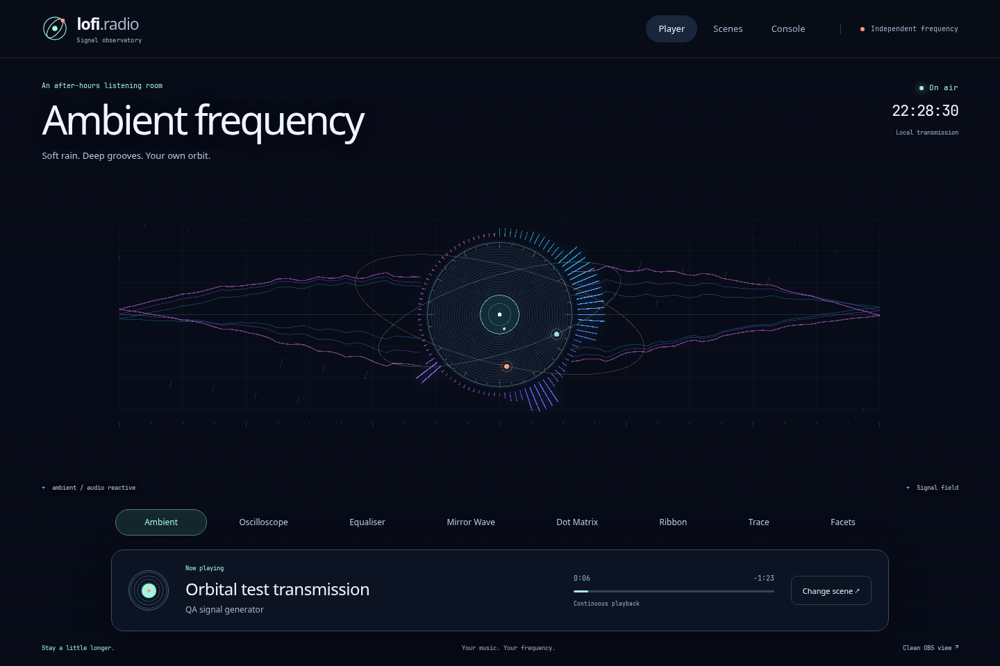
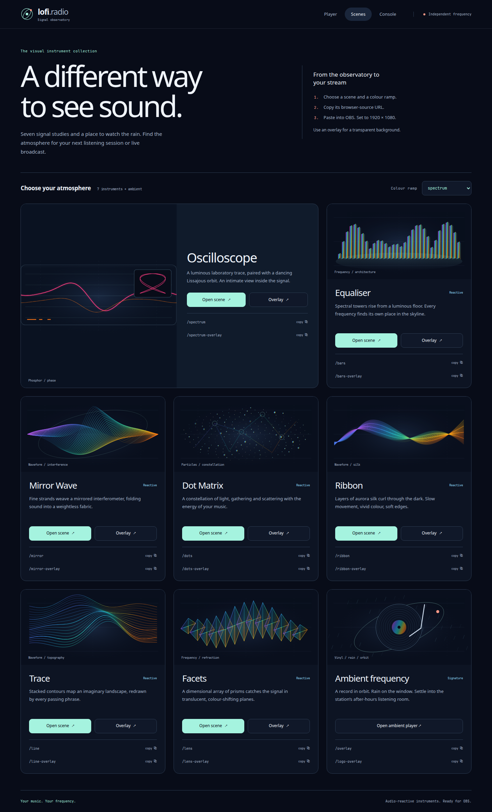
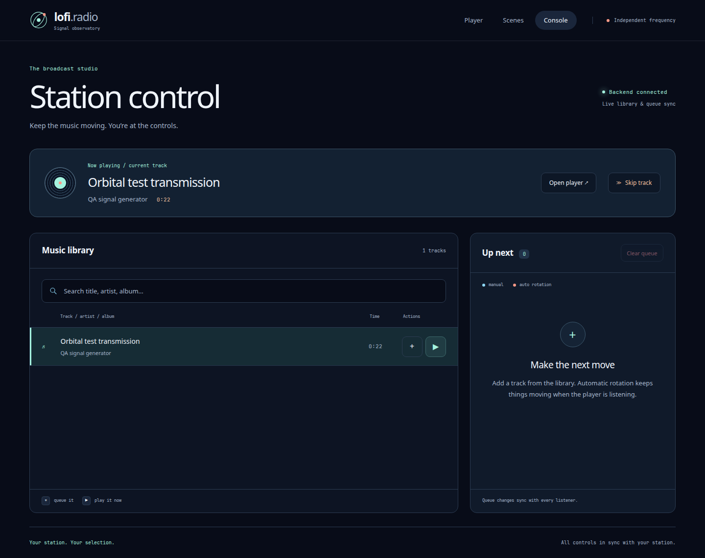
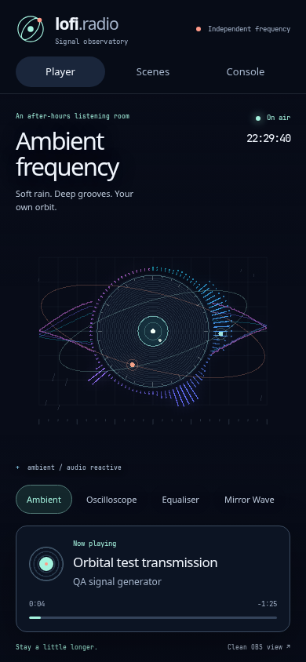

# Signal Observatory

The second design pass rebuilds the visual instruments themselves, not just the UI around them. Midnight-blue surfaces, mint and coral accents, editorial sans-serif headings, and self-hosted monospaced calibration labels give the station a modern after-hours studio identity.

## Eight distinct compositions

- **Ambient:** an engraved orbital record, logarithmic spectral needles, bent waveform ribbons, moving satellites, and fine rain.
- **Oscilloscope:** triggered phosphor traces, sparse persistence trails, and a delay-derived phase portrait. The second trace uses delayed mono analysis; it is not a stereo-channel measurement.
- **Equaliser:** segmented spectral towers, peak flags, shallow reflections, and separate bass/mid/air meters.
- **Mirror Wave:** seven pairs of woven signal filaments inside the measured waveform envelope.
- **Dot Matrix:** a curved frequency-lit constellation sheet, deep stars, and sparse diffraction points.
- **Ribbon:** five translucent, independently folded aurora-silk surfaces.
- **Trace:** fifteen receding contours drawn from a bounded history of recent audio.
- **Facets:** separated glass prisms with frequency-driven height, triangular caps, and refracted seams.

All instruments support `SPECTRUM`, `AURORA`, `EMBER`, `NEON`, and `VU` ramps. Gallery previews, scene links, copied URLs, and scene switching retain the selected ramp. Before playback, the player explicitly labels the composition **idle study**; these synthetic visuals produce no sound.

## Interface and rendering

The player has an open performance area, an eight-scene switcher, and a compact floating track deck. The gallery uses lightweight SVG studies rather than spawning extra audio clients or GPU contexts. The console retains library search, queue controls, confirmation, error recovery, and keyboard access.

Opaque player canvases fit the actual performance rectangle. A resize observer updates that rectangle when the audio-unlock message, viewport, or responsive layout changes, so artwork does not sit behind the playback deck. Clean `/overlay`, `/logo-overlay`, and scene `-overlay` sources remain full-screen and chrome-free. Transparent sources retain genuine transparent framebuffer pixels.

Static calibration geometry is rebuilt on resize. Dynamic surfaces reuse buffers, history is bounded, and bloom is restrained. Filters, gradients, and analyser taps have explicit cleanup. Quiet-track visual gain is capped and eased. Reduced motion renders a complete still composition, redraws it on resize, and leaves audio playback and progress running. No FPS improvement is claimed without a comparative GPU benchmark.

## Screenshot gallery

Desktop captures use a 1440 × 960 viewport. Mobile captures use 390 × 844. The gallery tablet capture uses 768 × 1024. Playback screenshots use generated MP3 test tones and an isolated real backend; no music is bundled or added to your library.

### Player and instruments



- [Oscilloscope](spectrum-desktop.png)
- [Equaliser](bars-desktop.png)
- [Mirror Wave](mirror-desktop.png)
- [Dot Matrix](dots-desktop.png)
- [Ribbon](ribbon-desktop.png)
- [Trace](line-desktop.png)
- [Facets](lens-desktop.png)

### Collection and console





### Mobile



- [Blocked-audio mobile layout](player-mobile-blocked.png)
- [Mobile ribbon](ribbon-mobile.png)
- [Mobile collection](scenes-mobile.png)
- [Mobile console](console-mobile.png)
- [Tablet collection](scenes-tablet.png)

## Verification

```sh
cd frontend
npm run build
npm test
npx tsc --noEmit --target ESNext --module ESNext --moduleResolution bundler --lib ESNext,DOM --strict --skipLibCheck --types node tests/*.spec.ts playwright.config.ts
npm run test:ui
```

Verified results: production build passed; eight unit tests passed; test TypeScript checking passed; all 38 Chromium browser tests passed; backend `go test ./... -race` passed; and `git diff --check` passed. Axe scans reported no detected WCAG A/AA violations on the player, collection, console, and Equaliser at desktop, tablet, 390px, and 320px widths.

Browser tests start Vite on port 3100. Install Chromium first with `npx playwright install chromium`. The suite includes the existing accessibility and queue interaction checks plus actual rendered artwork, five-ramp pixel comparisons, controlled audio-frame response, real framebuffer alpha, first-frame/resize behavior, trusted keyboard playback of changing WAV tones, analyser frequency checks, reduced-motion playback, SVG preview pixels, and safe canvas placement in blocked mobile and short-landscape layouts.

Separate real-backend checks streamed a generated MP3 on all eight player routes, unlocked audio by keyboard, observed **On air**, and received HTTP 206 audio responses with no JavaScript page errors. See [live results](live-verification.json).

Implementation used three independent file-owning agents for meter/prism scenes, waveform scenes, and UI design; a separate agent wrote visualizer regression tests, and another reviewed integration. The coordinator integrated the work, fixed the review's canvas-placement and scope-preview findings, and verified the result.

### Boundaries

- Actual OBS embedding, Firefox/Safari, physical audio output, and screen readers were not tested.
- Existing dependency audit findings were not remediated by this redesign.
- Vite's runtime `/config.js` bundling warning remains expected; Docker supplies that configuration at container startup.
- An empty music folder means there is no track to play. Add MP3 files to your configured music directory; the idle study is only visual.
