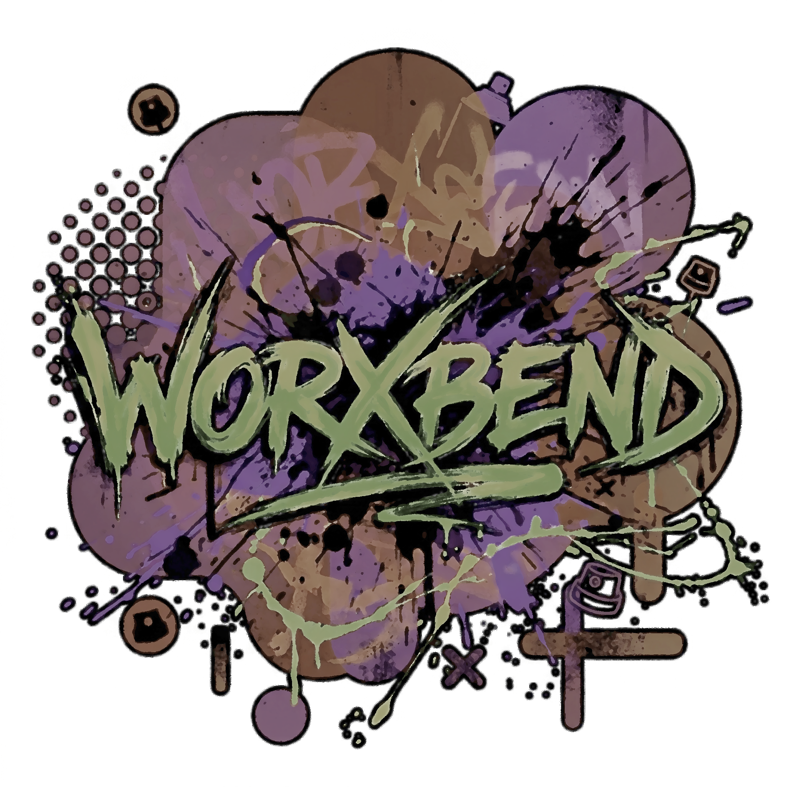

<div align="center">

<a href="../README.md"></a>

# 🎧 User Guide

### *Run it, feed it music, and pick a scene for your stream.*

[🏠 Home](../README.md) · [🗺️ Overview](overview.md) · **🎧 User** · [🛠️ Dev](developer-guide.md) · [🌐 API](api.md) · [🔌 WebSocket](websocket-protocol.md) · [⚙️ Config](configuration.md) · [🚀 Deploy](deployment.md)

</div>

---

## 🎵 What This App Does

It turns a folder of MP3s into a 24/7 radio station with a visualizer attached. The backend
picks the tracks; the browser page plays them and draws the visuals.

There is no "open file" button, no microphone input, and no play button. That is the point:
once it is running, it keeps running.

## 🚀 Running Locally

| Step | Do this |
|:--:|:--|
| 1️⃣ | Start the backend — see the [Deployment Guide](deployment.md) or just `go run ./cmd/api` |
| 2️⃣ | Start the frontend — `npm run dev` |
| 3️⃣ | Open `http://localhost:3000` |
| 4️⃣ | If the browser blocks autoplay, click or tap anywhere once 👆 |

## 📁 Adding Music

Copy `.mp3` files into the backend music folder. By default:

```text
backend/music
```

Existing files are indexed when the backend starts. New files are detected **while the
backend is running** — including files dropped into nested subfolders — and are added to the
queue automatically. No restart, no import step. 🪄

> [!TIP]
> Metadata comes from ID3 tags. Files without tags fall back to the filename as the title.
> Without a TLEN tag, the duration is read from the MP3 frame headers (bitrate, or the
> Xing/Info/VBRI frame count for VBR files). Tag your files if you want the now-playing card
> to look right. 🏷️

## 🎬 Choosing a Scene

There is no in-page settings panel. Each visual style is its own route, so you pick one by
opening the matching URL. Open **`/scenes`** for a picker that lists them all with
copyable links.

| Scene | Route | Look |
|:--|:--|:--|
| 〰️ Oscilloscope | `/spectrum` | Single glowing trace with a cyan and magenta split |
| 📊 Equaliser | `/bars` | Rounded columns with peak-hold caps and a reflection |
| 🌊 Mirror Wave | `/mirror` | Dense mirrored bars — the audio-editor waveform |
| ⣿ Dot Matrix | `/dots` | Halftone columns of dots lit outward from the axis |
| 🎗️ Ribbon | `/ribbon` | Smooth gradient-filled blob that flows rather than flickers |
| 📈 Trace | `/line` | Sharp polyline with a colour sweep along its length |
| 💠 Facets | `/lens` | Overlapping mirrored diamonds, coloured like a level meter |

Every scene also has a **transparent** twin at `/<name>-overlay` — `/bars-overlay`,
`/mirror-overlay` and so on — with no background and no text, for compositing over other
sources in OBS.

Plus the two original pages:

| Route | Look | Background |
|:--|:--|:--:|
| `/` | 🌧️ Full lofi rain scene with now-playing card, progress bar and clock | Opaque |
| `/overlay` | 🪟 The same scene with the chrome removed | Opaque |
| `/logo-overlay` | ✨ Logo only | **Transparent** |
| `/now-playing` | 🏷️ Current title and artist as text | **Transparent** |

`/now-playing` is a text-only overlay, for example
`http://<host>/now-playing?align=center&size=40&hold=10`. `align` is `left`, `center` or
`right` (default `left`); `size` is the title size in px from 12 to 120 (default 32);
`hold` is seconds from 1 to 600: the title shows for that long after each song change,
then fades out (default 0, always visible); `art=1` shows the track's embedded cover art
beside the title when it has one. `theme` sets the look: `shadow` (default) is a soft
glow for dark scenes, `outline` adds a crisp dark edge that holds up over bright or busy
footage, and `pill` puts the text on a dark rounded backing for the brightest scenes.
`font` is `sans` (default) or `mono` (the bundled JetBrains Mono), for example
`/now-playing?align=center&theme=pill&font=mono`.

`next=1` adds an "Up next" line under the artist with the next queued title, for example
`/now-playing?next=1&align=center`. The line is hidden while the queue is empty, and it
follows the same `hold` fade as the title. If the connection drops silently, the overlay
notices within about a minute and reconnects by itself; a connection that has not
opened within 10 seconds is retried. When the backend shuts down, the title clears and
comes back once the backend is up again. It plays no
audio, so pair it with the audio source page. It only listens to the backend and never
advances the queue, so it is safe to add alongside a playing page.

`progress=1` adds a thin progress bar under the text, for example
`/now-playing?progress=1&align=center`. It follows the elapsed time the server sends with
each song, so it is also in the right place after an OBS reload mid-track, restarts on each
new song and keeps going through a tag edit. It is hidden when the song has no known
duration, fades with `hold` like the text, and moves in discrete steps when the system asks
for reduced motion. Its position is approximate: it counts from when the server sent the
song, a moment before the audio is heard.

`ticker=1` keeps the title on one line, for example `/now-playing?ticker=1&align=center`.
A title that fits stays still; a title too long for the overlay scrolls slowly to its end
and back. When the system asks for reduced motion it does not scroll and ends in an
ellipsis instead. Without `ticker` a long title wraps onto more lines.

The **Now playing text** card on the Scenes page builds this URL from align, size, hold,
theme, font, album-art, up-next, progress-bar and scroll-long-titles controls and copies it
for you.

### 🎨 Recolouring

Add `?ramp=` to any scene to change its palette:

| Ramp | Colours |
|:--|:--|
| `SPECTRUM` | Full rainbow sweep, pink through orange |
| `AURORA` | Cyan → green → yellow → coral |
| `EMBER` | Amber → orange → deep magenta |
| `NEON` | Cyan → indigo → violet |
| `VU` | Level-meter green → amber → red |

For example `/bars?ramp=EMBER` or `/mirror-overlay?ramp=NEON`.

Two more query parameters:

| Parameter | Effect |
|:--|:--|
| `?transparent=1` | Force a transparent background on any catalogue scene at `/<name>` |
| `?autoplay=1` | Start audio without waiting for a click |

## 📺 Using It In OBS

1. Add a **Browser Source**. 🖥️
2. Set the URL to one of the routes above — the transparent ones composite cleanly over
   other sources.
3. Size it to your canvas.

Overlay routes try to start audio automatically, because OBS browser sources have no one to
click them. The detection looks for the `obsstudio` global that OBS injects, so it happens
without configuration.

> [!WARNING]
> Only **one** page should be producing audio. Every playing page independently asks the
> backend for songs, so two of them will fight over the queue and you will hear two
> different tracks at once. Use one audio source and add silent visual overlays alongside
> it, or mute the extras in OBS. 🔇

## 🎚️ Controlling The Queue

The admin console at `http://localhost:3000/admin.html` gives you a searchable library, the
live queue, a recently played list, and buttons to queue, play-now, skip and clear. ⊘ next to a
track means "don't play this": the track leaves rotation, even after a restart, until you press
**Allow again** in the Blocked list. 🎛️ To replay a track from Recently played, press **Queue
again** to add it to the end of the queue, or **Play now** to interrupt the current track with
it. A blocked track is refused with "song is blocked".

The library sorts **A–Z** by default. Press **Recently added** to put the newest tracks first;
the console remembers your choice in this browser. A **New** badge marks every track added in
the last 24 hours. For files already in the music folder when the backend starts, "added" means
the file's modification time, so a restart does not make the whole library look new. Files you
drop in while it runs count from the moment they are found, and they appear in an open console
without a reload.

Anything else can drive it over HTTP:

```bash
# What's in the library?
curl http://localhost:8080/v1/songs

# Search it
curl 'http://localhost:8080/v1/songs?q=rain'

# Queue something
curl -X POST http://localhost:8080/v1/queue \
  -H 'Content-Type: application/json' \
  -d '{"song_id":"SONG_ID"}'

# Play something right now, interrupting the current track
curl -X POST http://localhost:8080/v1/queue:play-next \
  -H 'Content-Type: application/json' \
  -d '{"song_id":"SONG_ID"}'

# Skip whatever is playing
curl -X POST http://localhost:8080/v1/player:skip
```

Manual queue additions may repeat a song — that is your call to make. Automatic selection
uses `round_robin` by default and plays the whole library before repeating anything.

📖 Full endpoint reference → **[Backend API](api.md)**

## 🆘 Troubleshooting

| Symptom | Likely cause |
|:--|:--|
| 🔇 Nothing plays, badge says "Live" | Autoplay is blocked — click the page once, or add `?autoplay=1` |
| 🎵 Two songs at once | More than one page is producing audio; see the warning above |
| 📭 "waiting for track…" forever | The music folder is empty, or no file matched `music.extensions` |
| 🔴 Badge says "Offline" | The backend is not running, or `VITE_BACKEND_URL` points at the wrong host |
| 🏷️ Song titles are filenames | Those files have no ID3 tags |
